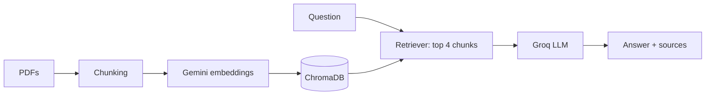

# 📚 Study Assistant: RAG Chatbot for Your Documents

Ask questions about your own PDFs and get answers with **page-level citations**. Answers come only from your documents. If the answer is not there, the assistant says so instead of guessing.


## Features

- **PDF upload:** drop in one or many PDFs from the sidebar
- **Smart indexing:** only new PDFs are processed; already indexed files are skipped
- **Grounded answers:** replies use only your documents and show the source file and page number
- **No guessing:** says "I could not find this in your documents." when the answer is missing
- **Chat memory:** follow-up questions like "give an example" or "who made it?" work
- **Streaming:** answers appear word by word

## How It Works



1. **Ingest:** each PDF is split into 1000-character chunks (150 overlap), embedded with Gemini, and stored in ChromaDB along with its file name and page number
2. **Retrieve:** the question (rewritten into a standalone question when there is chat history) is matched against the stored chunks, and the 4 closest are returned
3. **Generate:** the LLM answers using only those chunks and streams the reply, and the app shows which pages it came from

## Tech Stack

Python · LangChain · ChromaDB · Google Gemini (embeddings) · Groq (LLM) · Streamlit · uv

## Setup

**Requirements:** Python 3.11+, [uv](https://docs.astral.sh/uv/), a free [Google AI Studio](https://aistudio.google.com/) key, and a free [Groq](https://console.groq.com/) key.

```bash
git clone https://github.com/mohdarish4/study-assistant.git
cd study-assistant
uv sync
```

Create a `.env` file (see `.env.example`):

```
GOOGLE_API_KEY=your_key_here
GROQ_API_KEY=your_key_here
# Optional: choose a different Groq chat model
# GROQ_MODEL=llama-3.1-8b-instant
```

Run the app:

```bash
uv run streamlit run app.py
```

Then upload a PDF in the sidebar and start asking questions.

### Command-line version (optional)

```bash
# put PDFs in data/ first
uv run ingest.py   # build the vector database
uv run ask.py      # ask questions in the terminal
```

## Project Structure

```
study-assistant/
├── app.py          # Streamlit UI
├── rag.py          # indexing, retrieval, and answering logic
├── ingest.py       # CLI: build the database from data/
├── ask.py          # CLI: ask questions in the terminal
├── data/           # your PDFs (not committed)
├── .env.example    # template for API keys
└── pyproject.toml
```

## Evaluation

Tested on a 10-page PDF where each page covers a different topic. The table shows the page the answer should come from.

| Question | Expected page | Correct? |
|---|---|---|
| Who created Python and when was it released? | 1 | |
| What does HTTP status code 429 mean? | 2 | |
| What is a token roughly equal to? | 3 | |
| Which embedding model does this project use? | 4 | |
| What is FAISS? | 5 | |
| What chunk size and overlap are used? | 6 | |
| How many chunks does the retriever return? | 7 | |
| What is chain-of-thought prompting? | 8 | |
| What is ReAct? | 9 | |
| Where can AI demos be hosted for free? | 10 | |

Out-of-document questions (for example "Who is the prime minister of India?") correctly return "I could not find this in your documents."

## Roadmap

- [x] Stage 1: RAG pipeline with ingestion, retrieval, and citations
- [x] Stage 2: Streamlit UI, PDF upload, auto-indexing, and chat memory
- [ ] Stage 3: LangGraph agent that chooses between your documents and web search
- [ ] Deploy a live demo

## Notes

- Only text-based PDFs work. Scanned (image-only) PDFs have no text to extract.
- The free tiers of Gemini and Groq have rate limits. Large PDFs are indexed in small batches to stay within them.
